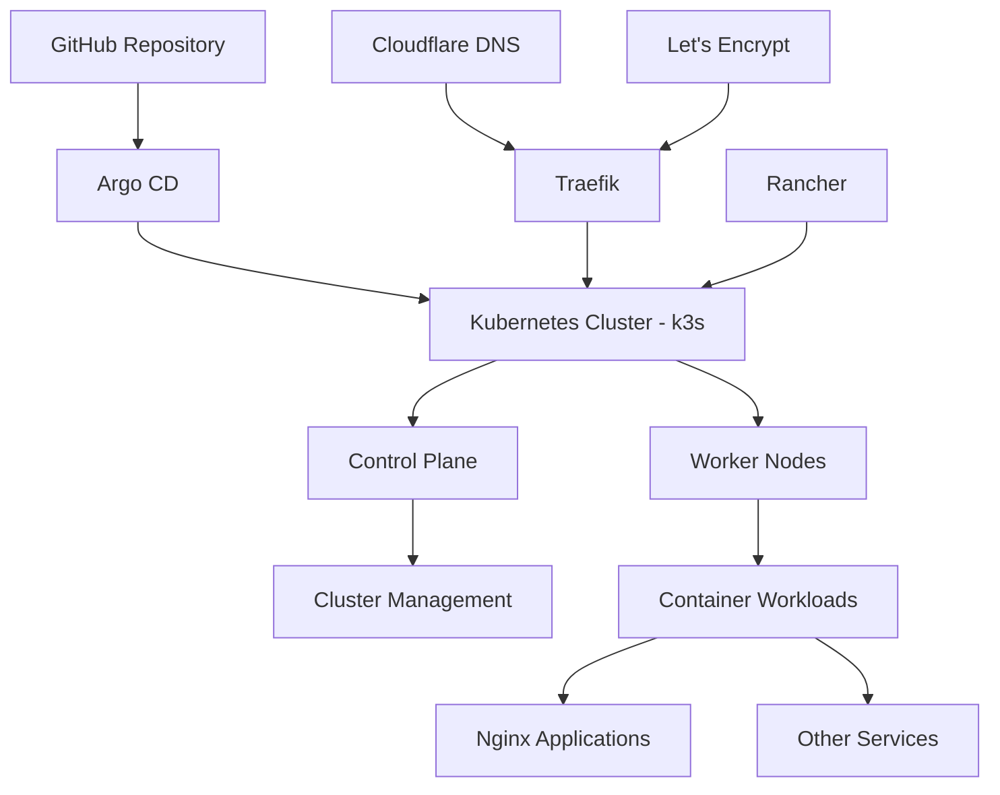

# ☸️ Kubernetes Lab

> Laboratório prático de Kubernetes, infraestrutura como código, automação e GitOps.


## 📌 Sobre o projeto

Este repositório reúne estudos, configurações, experimentos e implementações práticas relacionados ao ecossistema Kubernetes e às tecnologias utilizadas na administração de ambientes modernos de infraestrutura.

O objetivo é construir um laboratório de infraestrutura que permita explorar conceitos de orquestração de containers, automação de deployments, gerenciamento de clusters, integração contínua e entrega contínua (CI/CD), observabilidade e práticas DevOps.

O projeto também funciona como documentação técnica e repositório de referência para configurações, procedimentos e soluções desenvolvidas durante a evolução do ambiente.

## 🎯 Objetivos

- Implementar e administrar clusters Kubernetes.
- Explorar o k3s como distribuição Kubernetes leve.
- Gerenciar aplicações e recursos utilizando GitOps.
- Automatizar deployments com Argo CD.
- Gerenciar aplicações e configurações com Rancher.
- Implementar roteamento e publicação de serviços.
- Configurar certificados TLS e HTTPS.
- Trabalhar com containers, imagens e registries.
- Estudar persistência de dados e armazenamento distribuído.
- Aplicar boas práticas de segurança e monitoramento.

## 🏗️ Arquitetura do laboratório

O ambiente utiliza virtualização e infraestrutura Linux para disponibilizar os recursos necessários à execução do cluster Kubernetes.

### Visão lógica



*Diagrama conceitual da arquitetura. Os componentes e integrações são documentados conforme sua implementação no laboratório.*

## 🧰 Tecnologias utilizadas

| Tecnologia | Finalidade |
|---|---|
| Kubernetes / k3s | Orquestração de containers |
| Linux / Ubuntu | Sistema operacional da infraestrutura |
| Hyper-V | Virtualização |
| Docker | Containers e imagens |
| Rancher | Gerenciamento de clusters |
| Argo CD | GitOps e deployment contínuo |
| Traefik | Proxy reverso e Ingress |
| Nginx | Servidor web e aplicações |
| Cloudflare | DNS e integração com serviços externos |
| Let's Encrypt | Certificados digitais TLS |
| Git / GitHub | Versionamento e armazenamento das configurações |
| YAML | Definição declarativa dos recursos |

## 📂 Estrutura do repositório

```text
kubernetes-lab/
│
├── README.md
│
└── nginx-argocd/
    └── Configurações e experimentos
        relacionados ao Nginx e Argo CD
```

A estrutura será expandida conforme novos componentes, aplicações e procedimentos forem incorporados ao laboratório.

## ⚙️ Componentes e estudos

### Kubernetes / k3s

Implementação e administração de clusters Kubernetes utilizando k3s.

Principais tópicos:
- Arquitetura Control Plane e Worker.
- Deployments, Pods e Services.
- Namespaces e ConfigMaps.
- Secrets e Persistent Volumes.
- Networking e DNS interno.
- Escalabilidade e disponibilidade.

### Rancher

Gerenciamento centralizado da infraestrutura Kubernetes.

Estudos relacionados a:
- Administração de clusters.
- Gerenciamento de workloads.
- Monitoramento de recursos.
- Controle de acesso e usuários.

### Argo CD — GitOps

Automação e gerenciamento declarativo de aplicações através de repositórios Git.

Estudos relacionados a:
- Sincronização de aplicações.
- Deployments automatizados.
- Gerenciamento de manifestos.
- Estratégias de atualização e rollback.
- Integração com Kubernetes.

### Traefik e Ingress

Gerenciamento de tráfego HTTP/HTTPS e publicação de aplicações.

Estudos relacionados a:
- Reverse Proxy.
- Ingress e roteamento.
- TLS e certificados.
- Integração com Cloudflare.
- Let's Encrypt.

### Nginx

Implementação e publicação de aplicações web dentro do Kubernetes.

Estudos relacionados a:
- Deployments.
- Services.
- ConfigMaps.
- Exposição de aplicações.
- Integração com Argo CD.

## 🚀 Operação do laboratório

Os comandos abaixo são referências para administração de um cluster Kubernetes já configurado.

**Verificar os nós:**

```bash
kubectl get nodes -o wide
```

**Verificar os Pods:**

```bash
kubectl get pods -A
```

**Verificar os Services:**

```bash
kubectl get services -A
```

**Verificar os Deployments:**

```bash
kubectl get deployments -A
```

**Verificar os Namespaces:**

```bash
kubectl get namespaces
```

**Verificar os eventos do cluster:**

```bash
kubectl get events -A --sort-by=.metadata.creationTimestamp
```

## 🔐 Segurança

A segurança é considerada parte fundamental da implementação do laboratório.

Algumas práticas adotadas como referência:

- Utilização de HTTPS e certificados TLS.
- Controle de acesso aos serviços administrativos.
- Gerenciamento adequado de credenciais.
- Não versionar senhas, tokens ou arquivos kubeconfig.
- Utilização de Secrets para informações sensíveis.
- Restrição de acesso aos serviços de gerenciamento.
- Versionamento das configurações de infraestrutura.

**Importante:** arquivos contendo credenciais, certificados privados e configurações de acesso não devem ser publicados neste repositório.

## 🗺️ Roadmap

- [x] Criação do repositório de infraestrutura.
- [x] Início dos experimentos com Nginx e Argo CD.
- [ ] Documentação completa da arquitetura.
- [ ] Organização dos manifestos Kubernetes.
- [ ] Estruturação de deployments com GitOps.
- [ ] Integração de monitoramento e métricas.
- [ ] Implementação de estratégias de backup.
- [ ] Estudos de armazenamento persistente.
- [ ] Implementação de pipelines CI/CD.
- [ ] Documentação de procedimentos de recuperação.

## 📚 Referências oficiais

- [Kubernetes Documentation](https://kubernetes.io/docs/)
- [k3s Documentation](https://docs.k3s.io/)
- [Rancher Documentation](https://ranchermanager.docs.rancher.com/)
- [Argo CD Documentation](https://argo-cd.readthedocs.io/)
- [Traefik Documentation](https://doc.traefik.io/traefik/)
- [Docker Documentation](https://docs.docker.com/)
- [Nginx Documentation](https://nginx.org/en/docs/)
- [Cloudflare Documentation](https://developers.cloudflare.com/)

---

## 👨‍💻 Autor

**Charles Silva**

Analista de Infraestrutura, Redes e TI | DevOps | Linux | Kubernetes | Cloud Computing

- GitHub: [@silvacharles](https://github.com/silvacharles)
- Website: [rootsys.com.br](https://rootsys.com.br)

---

<p align="center">
  <strong>Infrastructure as Code. Automation. Orchestration. Continuous Learning.</strong>
  <br>
  Construindo, testando e documentando soluções de infraestrutura moderna.
</p>
